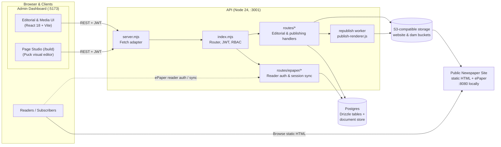
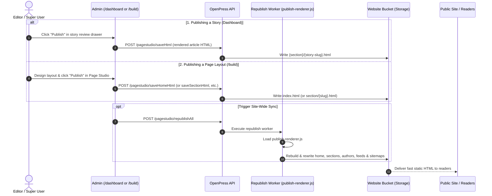

<div align="center">


**A free, open publishing platform for independent journalism.**
Write, review, design and publish a full newspaper website, with no paywall and no per-seat licences.

[](LICENSE)

**Live:** [Newspaper and ePaper](https://openpress-news.pages.dev) · [Newsroom dashboard (write and publish stories)](https://openpress-publish.pages.dev)

</div>

---

## Contents

- [What OpenPress is](#what-openpress-is)
- [Features](#features)
- [Architecture](#architecture)
- [Repository layout](#repository-layout)
- [Quick start](#quick-start)
- [Everyday commands](#everyday-commands)
- [How publishing works](#how-publishing-works)
- [Roles and access](#roles-and-access)
- [Configuration](#configuration)
- [Testing](#testing)
- [Deployment](#deployment)
- [Project status](#project-status)
- [Documentation map](#documentation-map)

## What OpenPress is

OpenPress is a newsroom CMS and a static newspaper site in one repository.

- **Journalists and editors** work in the **admin app**: they raise stories, move them through an editorial workflow, manage media and campaigns, run surveys and publish.
- **Super Users** also design pages in **Page Studio**, the in-app Page Studio (`/build`): the home page, section pages, article template and static pages.
- **Readers** get a fast, fully static website. Every page is plain HTML written to object storage, so it can be served from any CDN. There is no paywall; an optional ePaper reader sign-in (Google OAuth / 1-click preview demo with light frosted backdrop) provides authenticated subscriber access to special digital editions.

The database is Postgres and the file store is any S3-compatible service, so the whole stack runs on free tiers.

## Features

| Area | What you get |
| --- | --- |
| **Editorial workflow** | Kanban dashboard (Ideas, In progress, In review, Ready to publish), story editor with a block-based body editor, comments and review decisions, scheduled publishing, drafts. |
| **Page Studio** | Drag-and-drop layouts powered by [Puck](https://puckeditor.com). Story cards, grids, hero, section and article templates, ad placements, masthead navbar (announcements, social icons, action CTAs) and footer. Live preview updates, cross-page chrome sync, autosave, preview and one-click publish. |
| **Static publishing** | Pages render to HTML and are written to the website bucket. A site-wide republish rebuilds every page that has been published, plus sitemaps. |
| **Media library** | Upload, tag and search assets, thumbnails, optional AI tagging and video transcoding. |
| **Campaigns and ads** | Campaign manager, placements (leaderboard, in-story, sidebar) and click or impression tracking. |
| **Surveys** | Create surveys, publish them as pages, collect responses, optional AI summaries. |
| **Roles and permissions** | Super User, Admin, Editor and Reporter, with a per-module permission matrix. |
| **Newspaper design** | Premium masthead navbar that collapses to a compact bar with the quill mark on scroll, light footer, one system type family, rounded imagery, trimmed transparent brand assets (`openpress-logo-full-nobg-trim.png`), and frosted ePaper reader login modal. |
| **Optional paid services** | Image and video analysis, transcoding, email, web search and AI features (Gemini) are all **off by default** and switch on only when configured. |

## Architecture



Key ideas:

1. **One API, plain handlers.** Each route is a small `handler(event)` function. `src/server.mjs` adapts the standard `Request`/`Response` objects to that shape, so the same code runs on a local Node server and on Neon Functions.
2. **Postgres for everything.** Core entities (users, roles, taxonomies, stories, articles, pages, assets) have real Drizzle tables. Everything else lives in a JSONB `documents` table behind a the document store-compatible shim, so older handlers did not have to be rewritten.
3. **The site is static.** Publishing renders a page to HTML with the same code the editor previews with, and writes it to the website bucket. Readers never touch the API for page content.
4. **Page Studio is shared.** `apps/pagestudio` holds the editor, blocks and renderers. The admin app imports it through the `@studio` (and `@builder`) alias and mounts it at `/build`, and the API loads a built bundle of the renderers (`publish-renderer.js`) to republish the whole site.

## Repository layout

```
openpress/
├── apps/
│   ├── api/          Node API: router, handlers, Drizzle schema, seeds, tests
│   ├── admin/        Admin dashboard and the /build route (React 18, Vite)
│   └── pagestudio/   Page Studio editor, blocks, renderers, publish bundle (React 19)
├── brand/            Logo and icon source files
├── docs/             Plans and design notes
├── scripts/dev.mjs   Starts the API and admin together
├── docker-compose.yml  Local Postgres and S3-compatible storage
└── .github/workflows/  CI and deploy pipelines
```

Each app has its own README with the details: [API](apps/api/README.md), [Admin](apps/admin/README.md), [Page Studio](apps/pagestudio/README.md).

## Quick start

**Requirements:** Node 24 or newer, npm, Docker.

```bash
# 1. Install everything (npm workspaces)
npm install

# 2. Start Postgres and the local file store
npm run dev:infra

# 3. Create buckets, tables, roles and the first Super User (one time)
cp apps/api/.env.example apps/api/.env.local
npm run setup:local

# 4. (Optional) load sample users, taxonomies, media, 10 stories, page layouts and site logos
npm run seed -w apps/api

# 5. Build the renderer bundle the API uses to publish (once, and after editing renderers)
npm run build -w apps/pagestudio

# 6. Run everything
npm run dev
```

| Service | URL |
| --- | --- |
| Admin dashboard | http://localhost:5173 |
| Page Studio (Page Studio) | http://localhost:5173/build (Super User only) |
| API | http://localhost:3001 |
| Public newspaper | http://localhost:8080 |
| File-store console | http://localhost:9001 |

Sign in with the local Super User created by the setup step: `admin@openpress.local` / `admin12345` (change them with `SEED_ADMIN_EMAIL` and `SEED_ADMIN_PASSWORD` in `apps/api/.env.local`). These credentials exist for local development only.

> The first time, open `/build`, choose **Home**, and press **Publish**. Then use **ePaper** in the admin top bar to open the published site.

## Everyday commands

| Command | What it does |
| --- | --- |
| `npm run dev` | API (`:3001`), admin (`:5173`) and the local public site (`:8080`) together |
| `npm run dev:infra` | Start Postgres and storage in Docker |
| `npm run setup:local` | One-time: schema, buckets, roles, first Super User |
| `npm test` | All test suites |
| `npm run build` | Production builds of every app |
| `npm run seed -w apps/api` | All sample data below, in the right order (safe to re-run) |
| `npm run seed:stories -w apps/api` | 10 sample published stories |
| `npm run seed:pages -w apps/api` | Layouts for Home, 9 sections, Blog, About, Privacy, Editorial standards, Contact, Authors, Error |
| `npm run seed:site-assets -w apps/api` | Upload logos and icons to the website bucket |
| `npm run smoke -w apps/api` | Smoke-test a running API (`API_URL=... npm run smoke -w apps/api`) |

## How publishing works



- **Publish a story** from the dashboard: open a card in *Ready to publish* and press **Publish** in the details drawer. A story needs a featured image.
- **Publish a page** from `/build`: pick the page type, design it, press **Publish**.
- A **site-wide republish** runs after every publish and rebuilds all pages that have been published at least once.
- Locally the API reads the renderer bundle from `PUBLISH_RENDERER_FILE`. In deployed environments it downloads `/publish-renderer.js` from the admin site.

## Roles and access

| Role | Can do |
| --- | --- |
| **Super User** | Everything, including users, roles, taxonomy and Page Studio (`/build`). |
| **Admin** | Full editorial and library access. Creating users and roles is limited to Super Users by the API. |
| **Editor** | Full editorial workflow, library and surveys. |
| **Reporter** | Raise stories, ideas and drafts, and upload media. |

Per-module permissions (Create, Open, Edit, Decide) are stored on each role and edited in **Settings**.

## Configuration

Local defaults work out of the box. The settings you are most likely to change:

| Where | Variable | Purpose |
| --- | --- | --- |
| `apps/api/.env.local` | `DATABASE_URL` | Postgres connection (Neon in production) |
| | `JWT_SECRET` | Signing key for sign-in tokens, **change in any shared environment** |
| | `STORAGE_ENDPOINT_URL`, `PUBLIC_STORAGE_URL`, `S3_*_BUCKET_NAME` | Storage endpoint and bucket names |
| | `SITE_URL`, `FRONTEND_WEBSITE_URL` | Public site address used in saved URLs |
| | `ALLOWED_ORIGINS` | Browser origins allowed to call the API |
| `apps/admin/.env.local` | `VITE_BACKEND_API` | API address |
| | `VITE_SITE_BASE_URL`, `VITE_CANONICAL_URL` | Public site address (links, canonical tags) |

The full reference is in the [API README](apps/api/README.md#configuration).

## Testing

```bash
npm test                      # runs checks and admin tests
npm test -w apps/api          # syntax check of API router and server
npm test -w apps/admin        # 48 component and utility tests (Vitest)
```

## Deployment

The target stack is free-tier friendly:

| Part | Host |
| --- | --- |
| API | [Neon Functions](https://neon.com) (`apps/api/neon.ts`) |
| Database | Neon Postgres |
| Files | Neon Object Storage (S3-compatible) |
| Admin and `/build` | Cloudflare Pages (`openpress-admin`) |
| Public site | Static files in the website bucket, served from your domains |

GitHub Actions are in `.github/workflows`:

- `ci.yml` runs on every pull request and push: API check and tests, admin and Page Studio lint and build.
- `deploy-api.yml` deploys the API to the matching Neon branch and smoke-tests it.
- `deploy-web.yml` builds the admin app (which includes `/build` and the renderer bundle) and deploys it to Cloudflare Pages.

### Where it runs (no custom domain needed)

| What | Hosted on | Address |
| --- | --- | --- |
| Newsroom dashboard and Page Studio (`apps/admin`) | Cloudflare Pages, project `openpress-publish` | `https://openpress-publish.pages.dev` |
| Public newspaper (`apps/site`) | Cloudflare Pages project `openpress-news`, reading the published pages from the website bucket | `https://openpress-news.pages.dev` |
| API (`apps/api`) | Neon Functions | the function's Neon URL |

Set `VITE_SITE_BASE_URL` and `VITE_CANONICAL_URL` (admin build) and `SITE_URL` (API) to the newspaper's address so published pages carry the right links. With your own domain later, only these settings and the DNS change: add the domain to Cloudflare, attach it to the Pages project and attach it to the `openpress-news` Pages project.

There is one long-lived branch, `main`, and one environment, production. Work on short-lived branches, open a pull request into `main` (CI must pass), and every merge to `main` deploys.

## Project status

**Working today (local):** the editorial workflow, story publishing, Page Studio with seeded layouts, site-wide republish, the public site with the new masthead, role-based access, the media library, campaigns, surveys and the whole API (171 routes).

**Not done yet:**

- The Neon deployment and the Cloudflare Pages pipeline are written but have **not** been run against real accounts.
- The Page Studio API routes accept any signed-in user. Only the `/build` screen and its sidebar entry are limited to Super Users, so a server-side check is still to add.
- The privacy policy text is placeholder and needs a legal rewrite before launch.
- Local video thumbnails and transcoding need `ffmpeg`. Without it the optional features stay off.
- Puck prints a deprecation notice for its older drop zones. Migrating the blocks to slots is a separate project.

## License

OpenPress is open source under the [MIT License](LICENSE): use it, change it, run it commercially, and share it, as long as the copyright notice stays.
Contributions are welcome: open an issue or a pull request into `main`.

## Documentation map

| Document | Contents |
| --- | --- |
| [apps/api/README.md](apps/api/README.md) | API design, configuration, data model, full route reference, scripts |
| [apps/admin/README.md](apps/admin/README.md) | Admin app structure, routes, `/build`, configuration |
| [apps/pagestudio/README.md](apps/pagestudio/README.md) | Page Studio blocks, renderers, publish bundle |
