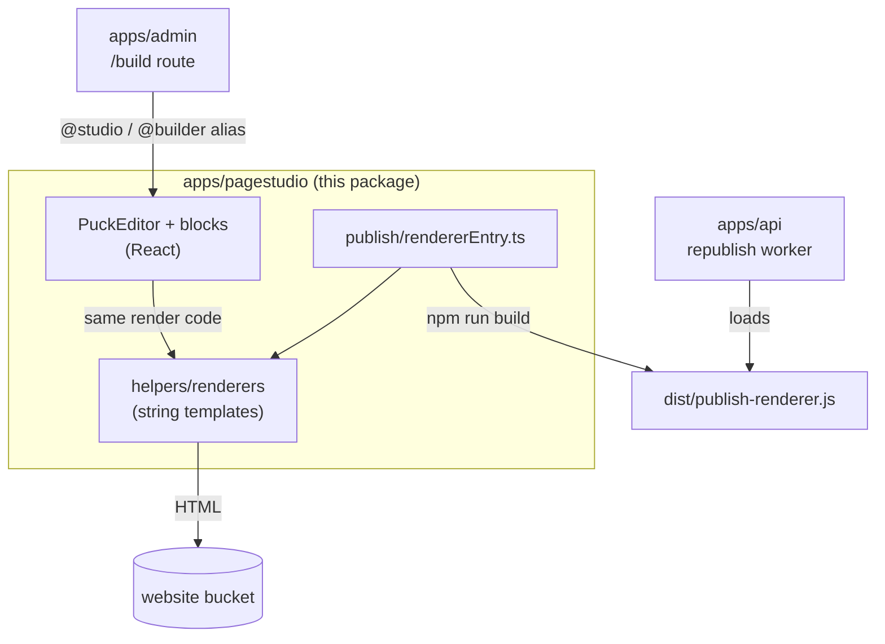

# OpenPress Page Studio

The visual editor, the content blocks and the HTML renderers that turn a saved layout into a newspaper page. This package is the *source* for three things:

1. **The editor.** The admin app mounts it at `/build` (Super Users only).
2. **The renderers.** The same code that draws a block in the editor draws it as static HTML when you publish.
3. **The publish bundle.** `dist/publish-renderer.js` is a single file the API loads to rebuild the whole site.

- **Stack:** React 19, Vite 7, TypeScript, Tailwind CSS 3, [Puck](https://puckeditor.com) 0.20
- **Main consumers:** `apps/admin` (through the `@builder` / `@studio` alias) and `apps/api` (through the publish bundle)

## Contents

- [How it fits together](#how-it-fits-together)
- [Run and build](#run-and-build)
- [Pages you can edit](#pages-you-can-edit)
- [Blocks](#blocks)
- [How a page is stored and rendered](#how-a-page-is-stored-and-rendered)
- [The publish bundle](#the-publish-bundle)
- [Design system for published pages](#design-system-for-published-pages)
- [Project layout](#project-layout)
- [Add a block](#add-a-block)
- [Configuration](#configuration)
- [Known limits](#known-limits)

## How it fits together



The editor shows each block as a React component. When you publish, the page is rendered a second time by plain string-template renderers (`helpers/renderers`) into complete HTML documents. The API can run those renderers too, through the bundle, so a site-wide republish needs no browser.

## Run and build

Normally you do not run this package on its own: start the whole stack from the repository root with `npm run dev` and open `http://localhost:5173/build`.

| Command | What it does |
| --- | --- |
| `npm run build -w apps/pagestudio` | Compiles the published-page CSS, type-checks, builds the app, then builds `dist/publish-renderer.js` |
| `npm run build:publish-renderer -w apps/pagestudio` | Only the publish bundle |
| `npm run build:published-styles -w apps/pagestudio` | Only the CSS that is inlined into every published page |
| `npm run dev -w apps/pagestudio` | The stand-alone editor on `http://localhost:5174` (optional, useful for debugging) |

**After changing a renderer or the stylesheet** run the build, then trigger a republish (`/build`, press **Publish**), because published pages embed the compiled CSS and the renderer bundle.

## Pages you can edit

The editor's **Currently editing** menu picks a page type. Each page is stored under a key.

| Page | Key | Notes |
| --- | --- | --- |
| Home | `Home` | Hero, thumbnail, popular, multimedia and all-stories grids |
| Section | `Section-<Name>` | One per taxonomy section (News, Opinion, ...) |
| Article template | `Blog` | Every story is rendered into this layout |
| About | `About` | |
| Privacy policy | `PrivacyPolicy` | |
| Editorial standards | `MediaCouncil` | |
| Contact | `ContactUs` | |
| Support Us | `SupportUs` | Amount chips and a UPI checkout through [YouPI PG](https://github.com/gxurav1710/YouPI-PG). Set `VITE_YOUPI_URL` and `VITE_YOUPI_PUBLIC_KEY`; the API confirms payments at `POST /youpi/webhook` (`YOUPI_WEBHOOK_SECRET`) |
| Authors list, author | `AuthorsList`, `Author-<id>` | |
| Error | `Error` | The 404 page |
| Videos, Video author | `Videos`, `VideoAuthor` | Extra layouts kept from the original product |

`npm run seed:pages -w apps/api` creates a ready-made layout for each of the main pages.

## Blocks

Blocks are grouped the way the editor palette shows them. Which blocks are offered depends on the page type (for example article blocks appear only on the `Blog` page).

| Group | Blocks |
| --- | --- |
| **Chrome** | Atlantic navbar (masthead), Footer |
| **Grids** | Hero grid, Thumbnail grid, Popular grid, Multimedia grid, All stories grid, Section grid, Section bottom grid |
| **Story cards** | Main card, Story card, Showcase card, Hover card, Recommend card, Featured card, Story sub card, Sidebar story card, Most popular table, Multimedia card, Border line, Heading |
| **Article** | Blog grid, Blog post card (the story), title, heading and sub-heading, image and body cards, popular and recommended cards, "more stories", share card |
| **Ads and placements** | Leaderboard ad, In-story ad, Sidebar ad, Advertisement grid, Ad card, Home leaderboard, Sidebar box |
| **Static pages** | About us, Privacy policy, Editorial standards, Contact us |
| **Authors** | Authors grid (automatic and manual), Author card, Author profile |
| **Utility** | Error card |

Cards take a **story** (picked from the published stories) and fill in the headline, image, section and summary themselves. Grids can run in **Automatic** mode on the Home page, filling their slots from the newest or most-read stories.

### Masthead Navbar Controls

The **Atlantic navbar** (`AtlanticNavbar` / `MastheadNavbar`) provides comprehensive visual controls directly in Page Studio:
- **Top Announcement Banner:** `showTopBanner` toggle, custom text `topBannerText`, background color `topBannerBgColor`, and text color `topBannerTextColor`.
- **Action Buttons:** `showSignIn` (Sign In / Subscriber button), `showSupportUs` (Support Us / Donate button), and `showBecomeMember` (Become a Member CTA).
- **Social Media Icons:** `showSocialLinks` master toggle, plus individual network toggles (`showTwitter`, `showFacebook`, `showInstagram`, `showLinkedin`, `showYoutube`).
- **Boolean State Management:** Uses strict boolean normalization (`toBoolean`) so that radio-button selections update the Puck editor canvas immediately and persist reliably in autosaved JSON.
- **Shared Chrome Propagation:** The Masthead Navbar and Footer configured on the `Home` page serve as the design foundation, automatically propagating shared styling and button visibility to section and flat pages via `homeChrome.ts`.
- **Layout Cleanups:** Obsolete experimental layouts such as `DesiFix` have been removed in favor of clean, unified responsive grid layouts.

## How a page is stored and rendered

A page is [Puck data](https://puckeditor.com/docs/api-reference/data-model/data): a `root`, a `content` array of top-level blocks and a `zones` map.

```jsonc
{
  "root": { "props": { "title": "Home" } },
  "content": [
    { "type": "AtlanticNavbar", "props": { "id": "home-navbar" } },
    { "type": "HeroGrid",      "props": { "id": "hero-grid", "mode": "manual" } },
    { "type": "Footer",        "props": { "id": "home-footer" } }
  ],
  "zones": {
    "hero-grid:hero-grid-center-0": [
      { "type": "MainCard", "props": { "id": "hero-main", "storyId": "seed-story-01" } }
    ]
  }
}
```

- A grid renders its slots as **zones**. A zone key is `<block id>:<zone name>`, for example `hero-grid:hero-grid-left-0` or `section-grid:section-grid-right-3`.
- The API stores the data in the `pages` table. `GET /pagestudio/page?pageType=Home` loads it, `PUT /pagestudio/autosave` saves a draft.
- A `publishedSnapshot` copy is stored when you press **Publish**. The site-wide republish rebuilds from that snapshot, so unpublished edits never leak onto the live site.
- To render, `helpers/render*PageFromPuckJSON.ts` builds the page shell (title, metadata, inlined CSS), and `helpers/registry/ComponentRegistry.ts` maps each block type to its renderer in `helpers/renderers`.

## The publish bundle

`src/publish/rendererEntry.ts` is the public API of `dist/publish-renderer.js`. It is a single self-contained ES module with this environment's `VITE_*` values baked in, so the browser and the server render byte-identical HTML.

| Export | Purpose |
| --- | --- |
| `RENDERER_API_VERSION` | The API refuses a bundle whose version it does not understand |
| `renderHomePage`, `renderFlatPage`, `renderSectionPage`, `renderAuthorPage`, `renderStoryPage` | Render one page to `{ html, savePayload }` |
| `flatPageTargets()` | The single-page types and the endpoint that saves each |
| `buildStoriesById`, `getPublishableData`, `applyChrome`, `seedAuthors`, `authorSlugFor`, `isUsableChromeLayout` | Data helpers the worker uses |

Rule: the module must not touch `window` or `document` at import time, because it runs in Node.

## Design system for published pages

Published pages use a premium newspaper look in the Apple style: one system sans, large headlines, generous space, hairline rules, rounded images and a light footer.

- All of it lives in **`src/styles/published-page.tailwind-entry.css`**, below the Tailwind layers. Change colours, radii and type there, then run `build:published-styles`.
- **Masthead navbar.** At the top of the page the navbar is a three-column masthead (date, logo, social icons) over a ruled row of section links. Once the scroll animation passes its halfway point the page gets the class `op-scrolled`: the navbar collapses to one frosted bar and the full logo cross-fades to the quill mark.
- **Logos.** Navigation uses `openpress-logo-full-nobg-trim.png` and `openpress-quill-nobg-trim.png`. The sources are in `/brand`; the trimmed copies are cropped to the visible art plus 2 px with transparent backgrounds. They are copied to `apps/admin/public` and uploaded to the website bucket by `npm run seed:site-assets -w apps/api`.
- **ePaper Reader Auth Modal.** When readers click "Sign In" on the published site or ePaper viewer, an auth dialog appears with a soft, light frosted-glass backdrop (`bg-black/25 backdrop-blur-[6px]`). The dialog provides Google Sign-In as well as 1-click preview demo access, automatically syncing reader subscriptions and issue tokens via `POST /epaper/auth/sync`.
- **Colours.** Every card has an **Accent colour** field, picked from the Color taxonomy, that tints its category chip. Each taxonomy value can also have a colour (Settings > Taxonomy); the published pages read them from `GET /taxonomy/colors`.
- **Publish bundle.** The local API loads `apps/pagestudio/dist/publish-renderer.js`: run `npm run build:publish-renderer -w apps/pagestudio` after changing a renderer or the stylesheet.
- **Footer.** `helpers/renderers/renderFooter.ts` renders it, and the editor preview calls the same function.

## Project layout

```
apps/pagestudio/src/
├── components/
│   ├── PuckEditor/
│   │   ├── PuckEditor.tsx          The editor: loading, autosave, page switching
│   │   ├── PuckOverrides.tsx       Header actions: page menu, Publish, Preview
│   │   ├── builderConfig.tsx       Which blocks each page type offers; default layouts
│   │   ├── CommonBlocksConfig.tsx  Block definitions (fields, defaults, render)
│   │   ├── CardBlocksConfig.tsx    Card block definitions
│   │   ├── blocks/                 React components for the editor canvas
│   │   ├── blogBuilder/            Article blocks
│   │   ├── layouts/                Page chrome for each page type
│   │   ├── storyData.ts, apiService.ts   Story, author and campaign data loading
│   │   └── republishAllClient.ts   Starts and tracks a site-wide republish
│   ├── PublishedPage/              Renders a published page inside the stand-alone app
│   └── AboutUs, PrivacyPolicy, MediaCouncil, ContactUs, Authors
├── helpers/
│   ├── renderers/                  One string-template renderer per block
│   ├── registry/ComponentRegistry.ts   Block type to renderer
│   ├── blog/                       Article page rendering
│   └── render*PageFromPuckJSON.ts  Full page documents
├── publish/                        The publish bundle entry and shared publishing logic
├── styles/                         The published-page stylesheet entry
├── generated/                      Compiled CSS for published pages (do not edit)
└── utils/auth.ts                   Reads the admin token from the cookie
```

## Add a block

1. **Editor component:** create `components/PuckEditor/blocks/MyBlock.tsx`.
2. **Definition:** add it to `CommonBlocksConfig.tsx` (or `CardBlocksConfig.tsx`) with `fields`, `defaultProps` and `render`.
3. **Offer it:** add its key to the right page types in `builderConfig.tsx`.
4. **Published HTML:** create `helpers/renderers/renderMyBlock.ts` and register it in `helpers/registry/ComponentRegistry.ts` (and in the blog renderer maps if articles use it).
5. Use Tailwind classes that exist in the renderers. The published stylesheet only contains classes found in `src/helpers`.
6. Build, then publish a page that uses the block and check the HTML.

## Configuration

`apps/pagestudio/.env.local` (also read when the bundle is built from `apps/admin`):

| Variable | Purpose |
| --- | --- |
| `VITE_BACKEND_API` | API address |
| `VITE_SITE_BASE_URL`, `VITE_CANONICAL_URL` | Public site address, written into canonical tags and social metadata |
| `VITE_SITE_NAME`, `VITE_TWITTER_HANDLE` | Names used in metadata (`OpenPress`, `@shreyanshtri26` by default) |
| `VITE_DOMAIN` | Cookie domain for the sign-in token |
| `VITE_YOUPI_URL`, `VITE_YOUPI_PUBLIC_KEY` | YouPI PG checkout for the Support Us page. Empty shows "payments not set up" |
| `VITE_GA_MEASUREMENT_ID`, `VITE_RUM_APP_MONITOR_ID` | Optional analytics. Empty means no tracking is added. |

## Known limits

- Blocks use Puck **drop zones**, which Puck has deprecated. They work today; moving to slot fields is a future project.
- Rendering exists twice by design (React in the editor, string templates for HTML). Keep them visually in step when you change a block.
- `src/components/PublishedPage` and the hash routes in `App.tsx` belong to the stand-alone app and are only used for the stand-alone preview.
- There are no unit tests in this package yet. The API tests cover page storage and the republish worker.
